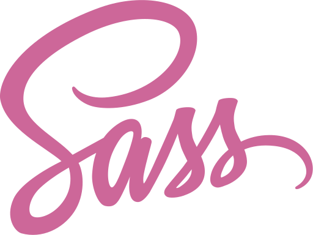
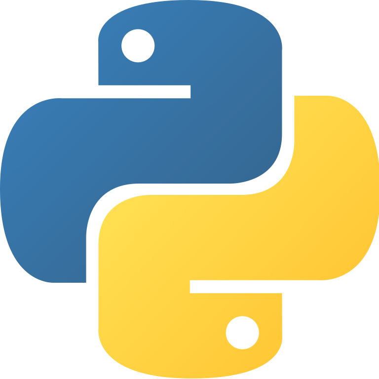
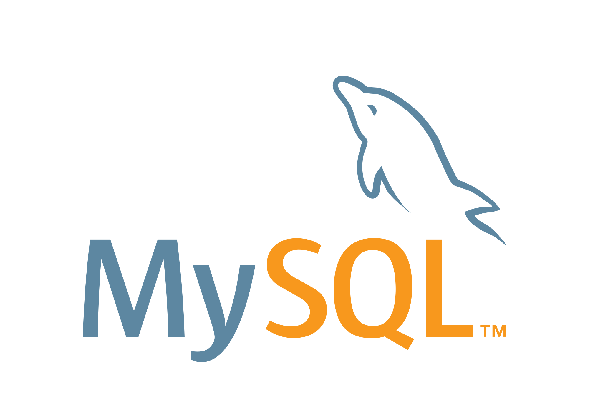
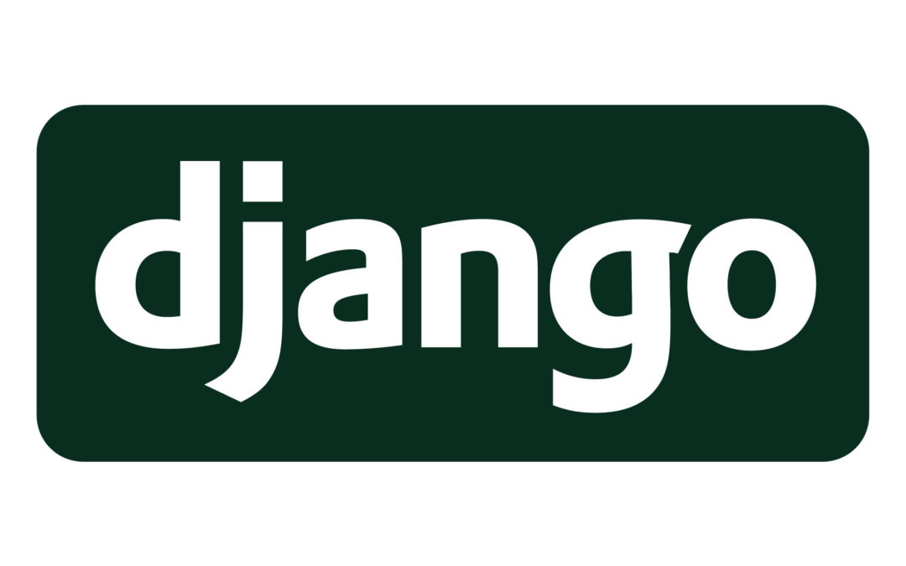
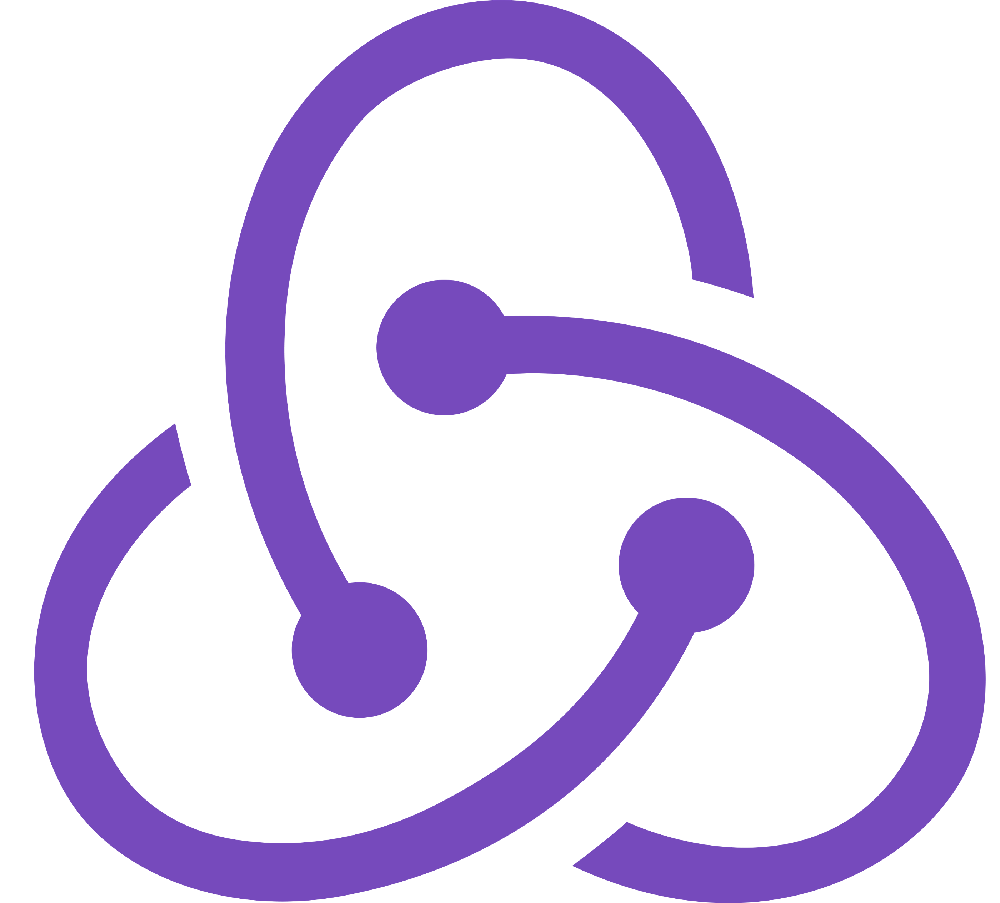
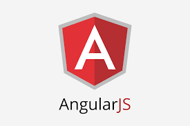

# 👋 I'm Niroshian B | Electrical Engineering Student | Full-Stack Developer

    Electrical Engineering student and full stack software developer with a strong desire to advance critical infrastructure and supply. Drawing on a rigorous background in full-stack development, database management, and automated testing, I bring a disciplined and analytical approach to systems integration, data analysis, and technical problem solving. I am eager to apply my skills in system modelling, reliability, and software-hardware integration to help optimize public infrastructure.

    
    
    

## 🛠️ Technical Skills:

    

## 💻 Programming & Software Development 

    
    
    
    
    
    
    
    
    

## 🔭 I’m currently working on:
    
    - Learning more advanced techniques using Python and Django Rest Framework to build Web APIs
    - Learning to use TypeScript
    - Getting AWS Certified
    

<!--
**niroshian-b/niroshian-b** is a ✨ _special_ ✨ repository because its `README.md` (this file) appears on your GitHub profile.

Here are some ideas to get you started:

-   💬 Ask me about ...
-
-   😄 Pronouns: ...
    -->
